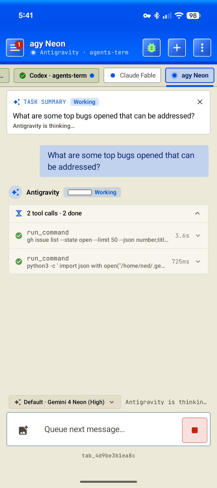

# AgentsTerm

[](https://github.com/AppEvol/agents-term/actions/workflows/ci.yml)
[](https://appevol.github.io/agents-term/)
[](https://appevol.github.io/agents-term/)
[](https://appevol.github.io/agents-term/)
[](https://appevol.github.io/agents-term/)
[](https://appevol.github.io/agents-term/)

Android app for running persistent coding agents (**Antigravity (`agy`)**, **Claude Code (`claude`)**, **Codex (`codex`)**, and **Shell**) on your Linux VM over [Tailscale](https://tailscale.com/).

Sessions run inside a lightweight daemon on your VM, so agents keep working even when you leave the app or lock your phone.

<p align="center">
  
</p>

## What You Need

- **Android phone or tablet** (Android 7.0+) with **Tailscale** installed and signed in.
- **Linux VM** (`x86_64` or `aarch64`) on the same Tailscale tailnet with **Tailscale SSH** enabled (recommended) or standard SSH access.
- **Coding agent CLIs** you want to use (`agy`, `claude`, `codex`) installed on the VM's `PATH` and signed in (or use a **Shell** tab).

## Quick Start (Recommended: Tailscale)

### 1. Install the Android app

Download and open the latest verified APK on your Android device:

- **Latest APK:** <https://github.com/AppEvol/agents-term/releases/latest/download/AgentsTerm-debug.apk>

If prompted by Android, allow installing apps from your browser or file manager.

### 2. Enable Tailscale on both devices

Connect both your phone and your Linux VM to the same Tailscale tailnet. On the VM, confirm its Tailscale address and enable Tailscale SSH:

```sh
tailscale ip -4            # prints your VM's 100.x.y.z address
sudo tailscale set --ssh   # recommended for passwordless setup
```

### 3. Connect and set up your VM from the app

Open **AgentsTerm** on the **SSH Auto-Setup** tab:

1. Enter your VM's **Tailscale IP or MagicDNS host** (for example `100.71.219.26` or `dev-vm`) and **VM SSH Username**.
2. Keep **Tailscale SSH** selected (or choose **Private Key** / **Password** if you use OpenSSH instead).
3. Tap **SSH & Bootstrap VM**.

AgentsTerm connects over SSH, installs and verifies the VM daemon automatically, starts it in the background, and opens your workspace.

> **Already running the daemon?** Switch to **Direct / URI**, run `~/.agents-term/bin/agentsterm-daemon pairing` on your VM, and tap **Paste Pairing URI from Clipboard** (or enter the Tailscale IP, port, and bearer token manually). See [VM Daemon Setup & Operations](docs/vm-daemon.md) for manual installation.

## Basic Usage

- **Create a tab:** Tap **New Agent Tab** (`+`), choose an agent (`Antigravity`, `Claude Code`, `Codex`, or `Shell`), browse to a working directory on your VM, pick a model and tool permission mode, and tap **Create Tab**.
- **Switch or manage tabs:** Open the **tabs drawer** (top-left) to jump between up to 10 persistent tabs, close finished tasks, or reopen **Recently closed** tabs.
- **Send, queue, or interrupt:** Type in the composer to chat or run commands. Sending while an agent is busy queues the message; **hold the stop button** to interrupt a running turn. Tap the attach icon to send photos or screenshots to coding agents.
- **Change models & settings:** Tap the **model chip** to switch models or check usage limits. Open **More options (`⋮`) → Settings & Debug** to pick a theme, edit your VM connection, or copy a setup autofill link for future reinstalls.

## Troubleshooting

- **Can't reach the VM:** Make sure Tailscale is connected on both your phone and VM, and that your VM firewall allows TCP port `7501` on the `tailscale0` interface.
- **Agent shows `not found`:** Install the agent CLI in `~/.local/bin` or `/usr/local/bin` so it is on `PATH`, and sign in on the VM.
- **SSH host key mismatch:** If you rebuilt your VM, tap **Trust New Host Key & Retry** in the bootstrap console.

For token rotation, manual daemon setup, and other VM issues, see [VM Daemon Setup & Operations](docs/vm-daemon.md).

## Documentation

- [VM Daemon Setup & Operations](docs/vm-daemon.md) — Manual installation, service persistence, CLI commands, token rotation, and troubleshooting
- [Daemon API Contract](docs/daemon-api.md) — HTTP and WebSocket protocol between the app and VM daemon
- [Architecture](docs/architecture.md) — System topology, `$HOME/.agents-term/` layout, and tab storage
- [Development & Releases](docs/development.md) — Building the Android APK, running tests, static checks, and CI releases
- [Live Debugging](docs/live-debugging.md) — Inspecting and driving the app from VM agents (`agents_term_app_cli`)
- [Test Dashboard (Allure 3)](https://appevol.github.io/agents-term/) — Live test results, per-suite metrics, and multi-run trend history from `main`
